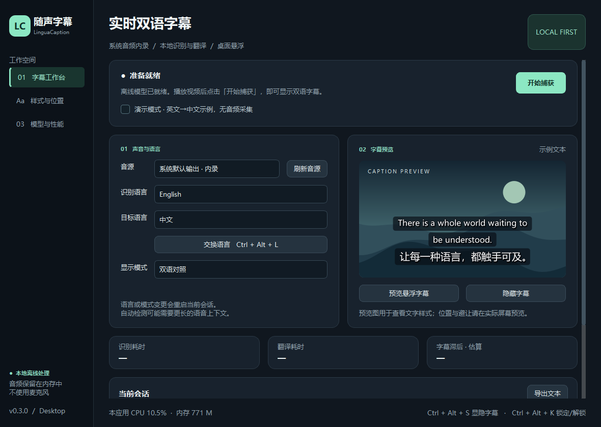

# LinguaCaption

[](https://github.com/zhangmingfeng962-cyber/LinguaCaption/actions/workflows/ci.yml)

[中文说明](README.md) · [Releases](https://github.com/zhangmingfeng962-cyber/LinguaCaption/releases)

A local-first desktop prototype for bilingual captions over video on Windows and macOS. It captures system output audio, transcribes speech locally, translates locally, and renders an independent always-on-top caption window.



## Current status

This is a **desktop software preview**, with public source code under the MIT license. The v0.3.0 desktop downloads bundle multilingual Whisper tiny and M2M100 418M INT8 models and do not require Python or a separate model download.

v0.3.0 defaults to white captions, the system font, and a dark shadow. Chinese captions and exports use Simplified Chinese. Complete captions are held for at least four seconds; twelve seconds without new content hides them. Both durations are configurable. Dragging stays stable during live updates, a hover drag handle is available, and capture starts unlocked. Legacy settings migrate once; later customizations are preserved. See [change and upgrade details](docs/READABILITY.md).

- Windows: WASAPI loopback capture through SoundCard.
- macOS 13+: a native Swift ScreenCaptureKit helper that builds in macOS CI; recording permissions and runtime capture require validation on a target Mac.
- Offline multilingual Whisper recognition and M2M100 translation through CTranslate2.
- Twelve exposed languages: Chinese, English, Japanese, Korean, Spanish, French, German, Russian, Portuguese, Italian, Arabic, and Hindi.
- Original, translated, and bilingual modes; fonts, colors, outline, shadow, line limits, per-line adaptive backgrounds, draggable placement, and mouse passthrough.
- Manually selected protected screen regions with automatic caption repositioning. There is no face detection or subject tracking.

**The 500 ms latency and 95% accuracy targets have not been accepted.** One 11-second English fixture produced about 426 ms median bilingual software lag and 1,012 ms P95; this excludes actual system capture and GUI paint latency. The normalized final transcript had zero WER on that single fixture. These results do not establish multilingual quality or long-run performance. See [validation](docs/VALIDATION.md) and [acceptance criteria](docs/ACCEPTANCE.md).

Those measurements describe the original inference replay. The v0.3.0 reading buffer deliberately adds display delay to keep captions readable; its minimum reading time is independent of recognition speed.

## Install and use

Download from [v0.3.0](https://github.com/zhangmingfeng962-cyber/LinguaCaption/releases/tag/v0.3.0):

- Windows 10/11 x64: run `LinguaCaption-0.3.0-windows-x64-setup.exe`. Installation is per user and does not require administrator privileges.
- Windows portable: extract the complete `LinguaCaption-0.3.0-windows-x64-portable.zip`, then open `LinguaCaption.exe`. Keep its `_internal` directory.
- macOS 14+, Apple Silicon: open `LinguaCaption-0.3.0-macos-arm64.dmg` and drag the application into Applications.
- macOS 14+, Intel: use `LinguaCaption-0.3.0-macos-x64.dmg`.

Play a video, choose the spoken and target languages, turn off demo mode, and start capture. The default is English to Chinese. Models load locally; the application can run offline. Settings are written to the current user's configuration directory.

This preview has no commercial Windows code signature, and the Mac build is ad hoc signed without notarization. Verify the repository and published checksums when opening an unknown-publisher download. On macOS, follow the system's Privacy & Security prompt to allow opening and grant Screen & System Audio Recording permission. Native capture and fullscreen behavior on physical Mac hardware still require acceptance testing. See [desktop distribution details](docs/DESKTOP.md).

## Run from source

Python 3.11–3.13 is required; 3.12 is recommended. Clone or download the source archive:

```bash
git clone https://github.com/zhangmingfeng962-cyber/LinguaCaption.git
cd LinguaCaption
```

Windows PowerShell:

```powershell
py -3.12 -m venv .venv
.venv\Scripts\python -m pip install -e ".[dev]"
.venv\Scripts\python -m linguacaption --demo
```

macOS, with Xcode Command Line Tools installed:

```bash
python3.12 -m venv .venv
.venv/bin/python -m pip install -e '.[dev]'
bash scripts/build_macos.sh
.venv/bin/python -m linguacaption --demo
```

Demo mode uses labeled English/Chinese sample text without audio capture or models. The current desktop interface is in Chinese; the sidebar pages are the workbench, appearance/position, and models/performance.

## Prepare offline models

Using the virtual environment's Python, run these explicit **network-enabled preparation commands** from the project root:

```bash
python -m pip install -e '.[prepare]'
python scripts/prepare_models.py asr --size base
python scripts/prepare_models.py translation
python -m linguacaption
```

On Windows, replace `python` with `.venv\Scripts\python`; on macOS, use `.venv/bin/python`. In the models page, choose the complete `models/asr` and `models/translation` directories. Turn off demo mode and start capture. Original-only mode does not require a translation model.

Translation preparation downloads roughly 2 GB of original model weights and converts them to INT8; extra disk space and RAM are required for conversion. PyTorch and Transformers are preparation dependencies, not runtime requirements. The runtime loads complete local directories and does not automatically fetch missing models. Audio stays in memory; text is saved only through an explicit export.

macOS requires Screen & System Audio Recording permission. Global shortcuts require Accessibility/Input Monitoring permission. Background glass effects depend on the OS compositor and fall back to translucent black when unavailable. Protected media and exclusive fullscreen may restrict capture or overlays.

## Development

```bash
python -m pytest -q
python -m ruff check .
python scripts/package.py
```

Build desktop packages on their target OS. Install `.[build]` and prepare complete `models/asr` and `models/translation` directories first; `scripts/package.py` bundles both by default. `scripts/distribute.py` creates a Windows installer and portable ZIP, or a Mac DMG. See [build instructions](docs/DESKTOP.md).

See the [project tree and full usage guide](README.md), [architecture](docs/ARCHITECTURE.md), and [contributing guide](CONTRIBUTING.md). Upstream dependencies and models retain their own licenses; desktop downloads contain their notices and model provenance.
