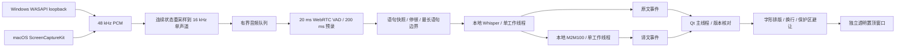

# 架构与实现约束

## 数据路径

Qt 主线程只进行控件、文字排版、几何计算和绘制。采集、分段、ASR、MT 及会话监督线程均在后台运行。模型运算由 CTranslate2 执行，UI 不等待同步推理。

## 时间与字幕版本

- `AudioChunk` 保存连续采样索引和单调时钟起点；`RecognitionRequest` 保存语句 ID、修订号、音频起点、最后语音时间以及是否终稿。
- 原文可在停顿前返回部分结果；每次解码整段当前语句，可修订前文。停顿 400 ms 后提交终稿；默认最多保留 6 秒语句。
- 原文和译文使用 `(run_id, utterance, revision)` 关联。翻译完成时先在引擎核对修订号，再由主窗核对当前原文。跨会话、跨语句及旧修订的译文不会回填到新字幕。
- 采集队列溢出丢弃最旧音频块，采样索引不连续会清空未完成语句、递增 generation。旧 generation 的在途识别不能恢复到界面。
- 停止后忽略已排队字幕事件，关闭邮箱唤醒等待线程。C++ 推理不能中途取消，重新开始需等待旧线程退出；Mac 捕获子进程会终止并回收。

原文出现后立即排队翻译。若译文落后，显示中的翻译可能暂时为空，终稿到达后再补齐。后台推理过慢时明确报告丢弃计数，不伪造速度指标。

## 资源边界

| 项目 | 上限 / 行为 |
|---|---|
| 音频队列 | 30 个采集块，正常约 1.5 秒 |
| 单语句 PCM | 默认 6 秒，可设 2–12 秒 |
| 待识别语句 | 3 个；同语句合并为最新修订 |
| 待翻译语句 | 2 个；同语句合并为最新修订 |
| 历史字幕 | 最近 60 条；新会话清空 |
| 引擎版本字典 | 最近约 9 个语句 |
| 保护区域 | 每屏最多 8 个 |
| 模型线程 | ASR 默认 4；翻译默认 2；各 1 个工作器 |

没有后台网络服务、本地监听端口或云端音频请求。没有音频文件录制。模型准备工具通过独立进程联网，下载目录/模型缓存由该工具和上游库管理；运行期仅读本地模型。

## 字幕绘制与避让

1. `regex \X` 按字素簇控制每行字数；结合 `QFontMetricsF` 的像素宽度控制侧栏及长英文，长单词可拆行。
2. `QTextLayout` 处理复杂文字整形、RTL 和后备字体，再提取字形轮廓。先描边、再填色，避免细笔画被描边覆盖。
3. 每行都有独立圆角背景，文字行短时背景同步变窄。正常状态不绘制工具栏背景；为悬停控件预留透明高度。
4. 将用户保护区从屏幕归一化坐标映射到全局逻辑像素，含负坐标显示器。候选坐标来自首选位置、屏幕边界、每个保护区边缘。
5. 排除碰撞候选，再按与首选位置的距离选最近位置。所有候选不可用时隐藏字幕，并通过主窗提示。避让考虑整个字幕窗口和工具条空间，保护区额外留 12 像素间隙。

字幕拖拽局限于当前选择屏幕，可在主窗切换到另一个屏幕。拖拽后的中心坐标按比例保存。预览卡只验证样式，真实避让使用独立悬浮窗。

Windows 磨砂给原生合成窗口设置逐行区域形状，Mac 用 Qt 透明视图后方的 NSVisualEffectView。系统不支持时使用透明黑底。相关原生视觉能力必须在目标系统上验证。

## 内录平台接口

Windows 用输出端点 ID 查找 loopback 输入，绝不使用默认麦克风。硬件通道先保留，再由应用降混为单声道。COM 按线程初始化，避免刷新设备与实际采集发生在不同线程时失效。连续重采样使用 PyAV 的有状态滤波器。

Mac 辅助程序只注册 `.audio` 输出。ScreenCaptureKit 配置 48 kHz 双声道、最小画面尺寸、低画面刷新频率，音频回调转换成 48 kHz float32 单声道，通过 stdout 管道交给 Python。stderr 仅传就绪/错误；系统权限失败时提示重试授权。辅助程序没有麦克风采集 API。

## 模型替换接口

`WhisperRecognizer.transcribe(samples) -> (text, language)` 与 `LocalTranslator.translate(text, source, target) -> text` 是最小替换边界。Engine 支持注入工厂，用于夹具重放和并发测试。

若 500 ms 是硬性全程指标，优先增加原生流式编码器/解码器接口，为每个已验收语言部署合适的 streaming 模型，并对 partial/final 分别验收。Whisper 窗口复算不能仅通过将 `update_ms` 改成 500 达成该指标。M2M100 可替换为更快的已验收语言对模型，保持界面事件协议不变。
