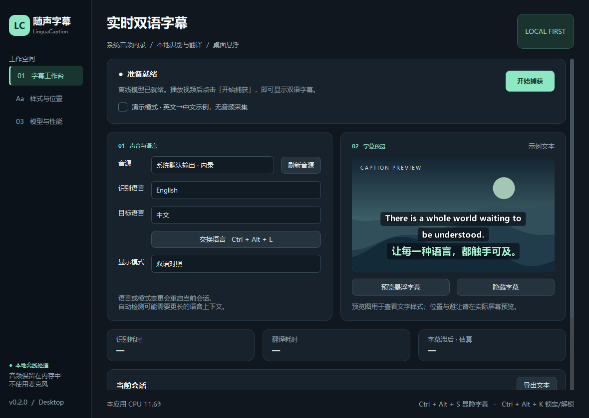
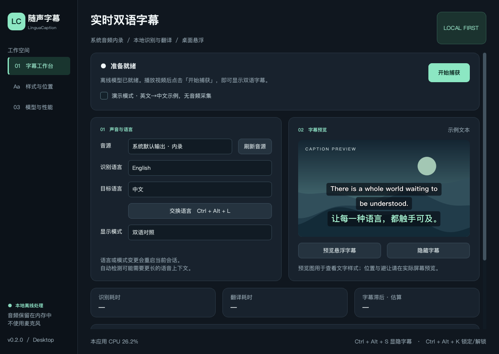

# 桌面发行与构建

当前版本为 v0.3.0，阅读时间、白色系统字体、简体中文、拖拽修复及升级方式见 [本次更新](READABILITY.md)。以下 v0.2.0 记录保留作初始桌面包验证依据；构建脚本会自动使用当前代码版本号。v0.3.0 复用同一份离线模型。

v0.2.0 是功能预览版。Windows 提供每用户安装程序和完整免安装包；Mac 提供 Apple 芯片与 Intel 两种磁盘映像，最低 macOS 14。所有完整软件包自带 Python 运行时、Qt、语音识别模型和翻译模型，使用者无需配置开发环境。

## 本版验证结果

详细机器可读记录见 [desktop-verification.json](desktop-verification.json)。程序代码构建自 commit `bb67bda90e48a5f8f3dee5766b307d4b7c636e6a`，后续提交补充发行验证文档与截图。

| 检查 | 结果 |
|---|---|
| Windows 实际 `.exe`，原生界面和无界面模式 | 识别 11 秒英文测试片段、执行本地翻译、绘制双语字形，均通过 |
| Windows 安装程序 | 静默安装成功；从 System32 工作目录启动安装后的程序，仍能找到内置模型并完成同一推理检查 |
| Windows 卸载程序 | 测试安装完整卸载，无需重启 |
| Windows 免安装 ZIP | 1077 个文件通过 CRC；模型逐文件 SHA-256 与上游准备清单匹配 |
| Mac Apple 芯片与 Intel | 两个真实 Mac CI 环境均构建 `.app`，加载离线 ASR 模型、执行翻译和绘制字幕，再生成 DMG |
| 源码 | 本地 33 项测试通过，ruff 通过；Windows / Mac GitHub CI 通过 |

Mac 检查没有采集真实设备的系统音频；也没有用文件音频执行 Mac ASR 解码。这些打包检查不能替代多语言质量、跨应用叠加、系统权限与长期性能验收。





## 使用与卸载

安装或完整解压后打开 LinguaCaption，播放视频，选择语言并点击开始捕获。模型首次加载需要等待数秒；无需登录或 API 密钥。未点击开始前不会采集系统音频。原文、译文和双语显示都在工作台切换。

Windows 安装在当前用户的本地程序目录，可通过「设置 → 应用」卸载；免安装版关闭程序后可移走其完整目录。Mac 把应用程序移至废纸篓即可。个人设置保存在 Qt 标准用户配置目录，卸载程序不会主动清除设置；会话音频不会写入磁盘。显式导出的 TXT 文件由使用者保存。

字幕应显示在播放器上方；独占全屏、受保护媒体及系统录制策略可能限制效果。可改用窗口化或无边框全屏播放器。Mac 系统音频权限由 ScreenCaptureKit 辅助程序请求；快捷键权限独立于系统音频权限。保护区为手工框选，没有人脸检测。

## 模型与许可证

完整包内置多语言 Whisper tiny（不是 tiny.en）以及 M2M100 418M，经 CTranslate2 INT8 转换。Tiny 优先控制 CPU 与软件体积；可在模型页切换更大的完整多语言识别模型目录。

模型目录内的 `linguacaption.json` 记录上游仓库、源 commit、转换格式及文件 SHA-256；本次模型来源亦见 [provenance.json](benchmarks/provenance.json)。独立模型包 `LinguaCaption-models-v1.zip` 提供相同文件，供复现构建使用，普通使用者不必下载它。

软件内的 `third-party-licenses` 保存模型 MIT 许可、Qt/PySide 的 LGPL/GPL 文本以及各依赖自带的许可与版本清单。Qt 动态库保持独立，可替换为兼容的修改版本；未对逆向调试此类修改施加额外限制。依赖和模型保留上游许可，项目自身源码使用 MIT。

## 复现构建

在与目标平台、架构一致的机器上使用 Python 3.12。请在干净虚拟环境安装构建依赖，不要使用安装了 PyTorch/Transformers 的模型转换环境，否则可能引入无关的大型依赖。

```bash
python -m pip install -e '.[build]'
python scripts/models_archive.py extract LinguaCaption-models-v1.zip models --sha256 0f6e8825f51ee400a8f7bf7940cdc3fba01cd7a3f46734b1eaa6ad177ab3e714
python scripts/package.py
```

可以用 `--asr-model`、`--translation-model`、`--dist-dir`、`--work-dir` 指定其他目录。`--without-models` 仅供开发，生成的软件没有完整包的即装即用体验。打包时包含 VAD wheel 专用 hook，Windows 构建还隔离无关工具的 DLL 搜索路径。

Windows 安装 [Inno Setup 6](https://jrsoftware.org/isinfo.php)，再运行：

```powershell
python scripts/distribute.py --dist-dir dist --output downloads --iscc 'C:\Program Files (x86)\Inno Setup 6\ISCC.exe'
```

Mac 需要 Xcode Command Line Tools，`package.py` 会编译原生系统音频辅助程序，再构建和临时签名 `.app`。生成磁盘映像：

```bash
python scripts/distribute.py --dist-dir dist --output downloads
```

构建脚本会同时写出下载文件的 SHA-256。Mac 自动构建由 [build-desktop.yml](../.github/workflows/build-desktop.yml) 驱动，固定源码 commit 并在解压前校验整个模型包和每个模型文件。软件启动时只读取包内本地模型，不联网下载缺失文件。

## 发行检查

`--self-test` 是显式调用的打包检查入口：加载包内模型，执行本地翻译和音频重采样，绘制本应用窗口并写出 JSON 与截图；可提供测试音频验证实际识别。该入口不会打开系统录制，也不会访问网络。

```powershell
.\dist\LinguaCaption\LinguaCaption.exe --self-test --self-test-report smoke.json --self-test-audio example.wav --config smoke-settings.json
```

Mac 对应可执行文件为 `dist/LinguaCaption.app/Contents/MacOS/LinguaCaption`。通过打包检查只证明软件和模型可加载、推理，并不证明所有语言、系统音频权限、实际端到端延迟或全屏叠加已验收。500 ms / 95% 目标的实际边界见 [验收说明](ACCEPTANCE.md)。
