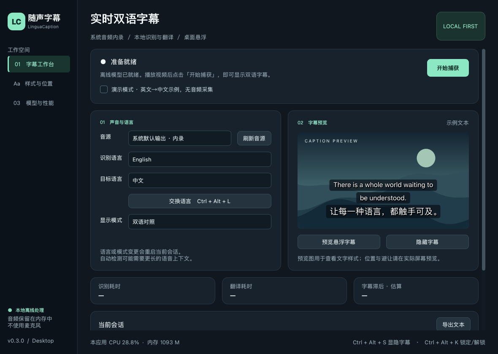

# v0.3.0 字幕阅读与拖拽修复

本次更新针对实际使用反馈：字幕替换太快、中文偶尔显示繁体、译文默认为绿色，以及捕获期间无法稳定拖动字幕。

## 使用行为

- 默认原文、译文都是白色，使用系统默认字体、常规字重、黑色描边和柔和阴影。可在「样式与位置」恢复系统字体或继续自定义样式。
- 中文识别原文和中文译文在本地统一为简体，显示、会话记录、手动导出保持一致。使用随包附带的 OpenCC 字典，不联网；日语等其他语言的汉字不会被转换。
- 新句替换前，当前字幕至少保留 4 秒；译文到达后重新给予完整阅读时间。同一句的未完成识别更新合并到约 1 秒一次；已有完整双语内容时，等待匹配译文后再更新，避免译文闪空。
- 12 秒没有新内容后隐藏字幕；静音或空的识别结果不会立即清屏。停止捕获和音频中断会清除显示与等待队列，避免旧字幕重新出现。
- 「样式与位置」可调最短停留 1–10 秒、无新内容隐藏时间 2–30 秒。增加停留时间会增加观看滞后。连续快语音只保留最近 3 个待显示句子，避免无限积压；完整的最近 60 条内容仍在会话记录中。
- 开始捕获时自动解除位置锁定。按住字幕文字、背景或悬停工具条上的「↔ 拖动」即可移动；拖拽期间收到的新内容会在松开后显示，不再把窗口拉回预设位置。
- 松开后保存为自由位置；仍遵守屏幕边界和手工保护区。观看时可用 Ctrl+Alt+K 锁定并启用鼠标穿透，再按一次解锁。

从 v0.2.0 更新后，会在首次加载旧设置时自动应用白色、系统字体、阴影、4 秒停留和 12 秒隐藏。字幕大小、语言、音频设备、模型和保护区等保留。迁移后新做的样式调整不会在下次启动时重置。Windows 可直接运行新安装包覆盖升级；免安装版完整解压到新目录，Mac 用新版应用替换旧版。

## 代码与回归检查

`core/presentation.py` 将阅读缓冲与识别吞吐分开，按语句合并修订并限制等待队列；`core/chinese.py` 只转换中文。`overlay.py` 在拖拽期间冻结布局刷新，松开后按同一安全边界保存中心坐标；拖动手柄转发实际鼠标事件。

45 项本地回归测试已通过，覆盖完整双语停留、迟到译文、陈旧修订、等待队列上限、繁简转换及日语保护、旧配置迁移与再次保存、空识别保留字幕，以及持续更新时从拖动手柄移动并保存位置。打包程序的显式自检也会验证转换字典、白色字形、4 秒阅读缓冲和拖拽期间的几何稳定性。

本次改善阅读体验会主动延长部分内容的显示滞后，500 ms / 95% 指标仍未验收。Mac 系统权限、真实系统音频和跨应用全屏覆盖仍需真机验收；原有模型与隐私策略不变。

详细验证与下载文件哈希见 [readability-verification.json](readability-verification.json)。原生界面实际计时显示第一句保留约 4.08 秒后才被下一句替换，期间拖拽提交成功；该检查使用合成字幕事件，没有采集系统声音。Windows/Mac 源码 CI 均通过，两种 Mac 打包程序也通过了本地模型、转换字典、白色字形和拖拽检查。

